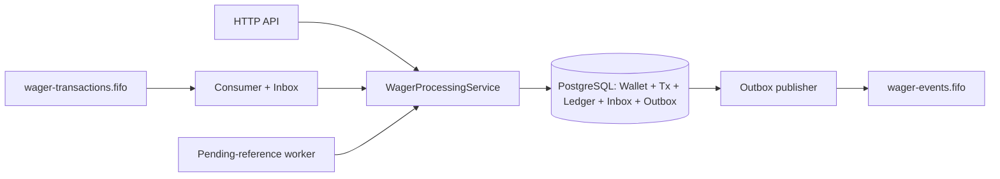

# ARCHITECTURE — Jungle Distributed Wagering Processor

## 1. Desenho

Monólito modular NestJS/TypeScript em Bun com PostgreSQL/MikroORM e SQS via LocalStack.
O serviço HTTP e o consumer da fila chamam o mesmo `WagerProcessingService`, preservando
uma única política financeira. As regras monetárias ficam em classes de domínio;
transações SQL, claims, índices e redelivery são responsabilidade da infraestrutura.

## 2. Money e invariantes

- `Money` recebe e serializa `{amount: string, currency: string}` com duas casas;
  `Decimal.clone({precision:40})` evita arredondamento antes dos checks do banco.
- Colunas `NUMERIC(20,2)` com checks protegem valores armazenados. A aplicação
  valida operações de moedas diferentes e rejeita entrada negativa/escala irregular.
- Wallet única por `(player_id,currency)`, `version=1` na criação, incremento somente
  quando o saldo muda. Saldo inicial positivo cria `OPENING` + ledger em um commit.
- Cada movimento tem um ledger imutável, com constraint aritmética,
  índice único wallet/transaction e trigger contra UPDATE/DELETE.
- Ao executar um movimento, o caso de uso reidrata `Wallet`, aplica débito/crédito
  e constrói `WalletLedgerEntry`, em vez de confiar apenas no ORM.

## 3. Atomicidade e concorrência

A unidade de serialização é a wallet: `SELECT FOR UPDATE` dentro de
`EntityManager.transactional()`. O mesmo commit engloba identidade da transação,
saldo, ledger, Inbox (SQS) e Outbox. Índices únicos são a garantia final de deduplicação.

Existem chaves únicas para `(provider_id,idempotency_key)` e
`(provider_id,external_transaction_id)`; JSON canônico de campos de negócio
gera `payloadHash` SHA-256. Payload diferente na mesma chave => conflito.
O snapshot persistido permite devolver saldo original em replay.
O caso de uso faz nova consulta idempotente **após adquirir o lock da wallet**
para não transformar concorrência legítima em `EXTERNAL_TRANSACTION_EXISTS`.

## 4. Regras de aposta

`BET` debita e rejeita falta de saldo; `WIN` credita; `LOSS` registra resultado
sem ledger/version. `REFUND` referencia apenas BET processada;
`ROLLBACK` referencia BET, WIN ou REFUND processada e inverte o lançamento.
Contexto exige mesmo provedor, player, wallet, moeda e rodada, com valor integral.
Uma reversão econômica direta por referência (ADR-013) impede crédito duplo.
Reversões que provocariam saldo negativo são REJECTED com código próprio.

`PENDING_REFERENCE` é reprocessada em worker periódico com backoff e TTL;
limite de tentativas/TTL leva a rejeição auditável e evento.
O `FAILED` representa estado terminal do contrato de domínio, mas quedas de DB
sem commit não podem ser registradas falsamente como transação financeira confirmada.
Mensagens incapazes de confirmar commit seguem a política de retry/DLQ.

## 5. SQS e Inbox

`wager-transactions.fifo` recebe comandos;
`wager-transactions-dlq.fifo` recebe mensagens após redrive.
O consumer valida contrato, grava Inbox por `(consumerName,messageId)` na
transação financeira e só envia `DeleteMessage` após o commit.
Erros não confirmados retornam à fila por visibilidade com backoff exponencial;
o redrive do broker decide a DLQ. O polling controla tarefas em voo;
shutdown impede novos receives e aguarda as tarefas em curso.

## 6. Outbox e eventos

Eventos exigidos: `WagerTransactionProcessed`, `WagerTransactionRejected`,
`WagerTransactionPendingReference`, `WalletBalanceChanged`.
São subclasses de `IntegrationEvent`, com `eventType`, `version`, `eventId`,
correlação e `MoneyProps` JSON. Nenhum evento é publicado antes de commit.
O publisher reclama linhas com `FOR UPDATE SKIP LOCKED`, token/lease, envia
fora da transação e marca `published_at` somente após `SendMessage`.
O contrato é **at-least-once**; consumidores downstream precisam deduplicar por
`eventId`, pois crash após envio e antes da marca SQL pode gerar reenvio.

## 7. HTTP, autenticação e observabilidade

Endpoints conforme README; `Idempotency-Key` obrigatório.
400 inválido, 409 conflito, 422 rejeição de negócio (inclusive replay rejeitado),
202 referência pendente, 404 inexistente e 503 dependência indisponível.
Cursor do ledger preserva timestamp PostgreSQL até microssegundos e valida formato/UUID.

O guard mantém `AUTH_MODE=challenge` permissivo e implementa autenticação opt-in
com `AUTH_MODE=oidc`: JWT RS256, JWKS, issuer, audience e identidade do provider.
Autenticação e autorização são separadas: `ResourceAuthorization` verifica no
PostgreSQL o vínculo issuer/subject/provider e a capability por wallet ou player.
O interceptor global mantém a verificação e o handler na mesma transação, com
locks compartilhados contra revogação. Operadores exigem grants próprios, além de papel e permission em JWT validado.
A [ADR-019](docs/adr/019-provider-resource-authorization.md) define a matriz,
o provisionamento e rollback. Não há propriedade exclusiva nem backfill de legados.

Logger emite uma linha JSON por evento com whitelist de campos operacionais,
sem payload financeiro completo/segredos. `/metrics` expõe métricas por instância,
`/health/live` responde ao processo e `/health/ready` verifica PG + SQS.
Reconciliação compara saldo materializado e ledger em consulta consistente,
com log/métrica de divergência e nenhuma correção silenciosa.

## 8. Trade-offs e limites

- Monólito modular mantém transação financeira SQL única; microserviços exigiriam
  protocolos adicionais de consistência sem benefício para o desafio.
- Lock pessimista reduz throughput de uma wallet quente, mas não bloqueia wallets diferentes.
- SQS FIFO auxilia ordenação/duplicatas, mas não substitui índices SQL nem Inbox.
- OIDC está implementado como opt-in; isolamento HTTP por recurso usa vínculos persistentes; o provisionamento
  administrativo e o ingresso autenticado de produção para SQS são responsabilidades operacionais. Dashboards, AWS real, testes de carga e observabilidade distribuída
  são opcionais ou externos ao escopo pontuado.
- Runner de CI usa PostgreSQL/LocalStack reais e testes por arquivo em série por causa
  de TRUNCATE dos fixtures; paralelismo **dentro** do teste distribuído é real.

Consulte [testes](docs/TESTING.md), [falhas e recuperação](docs/FAILURE_RECOVERY.md),
[ADRs](docs/02_ADR_REGISTER.md) e [rastreabilidade](docs/REQUIREMENTS_TRACEABILITY.md).

A política de métricas/claims administrativas está em [ADMINISTRATIVE_ACCESS](docs/ADMINISTRATIVE_ACCESS.md):
OIDC exige papel operacional + scope para métricas; challenge production desabilita
por padrão, preservando operação pública local do desafio. Health permanece público.
