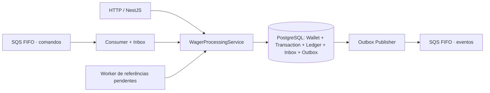
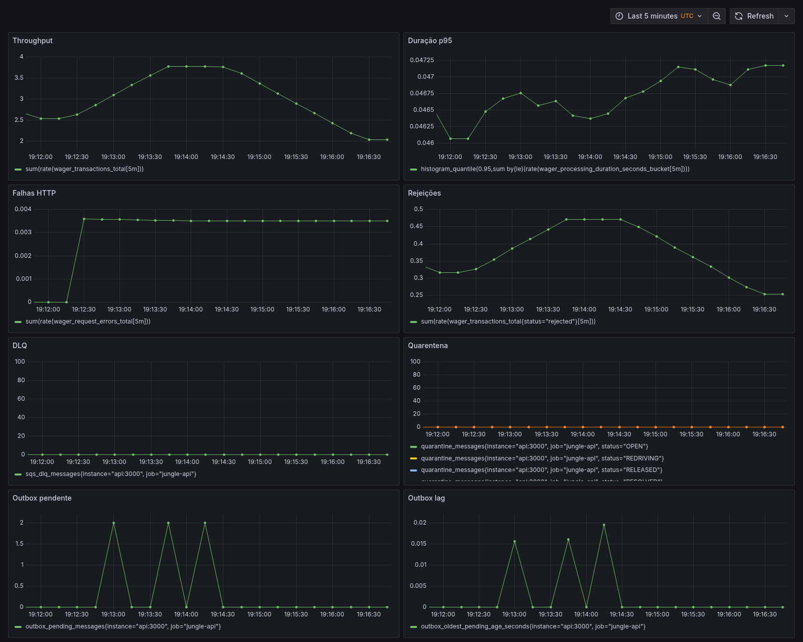
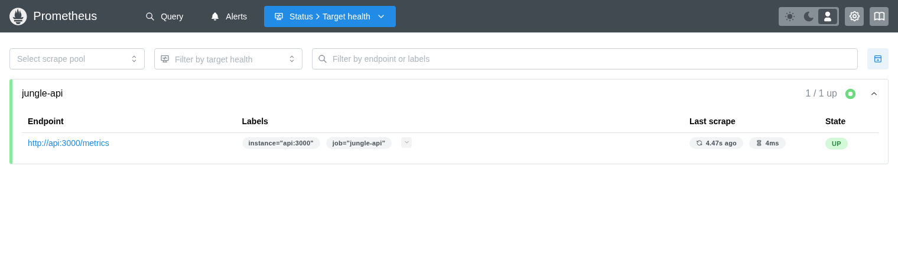
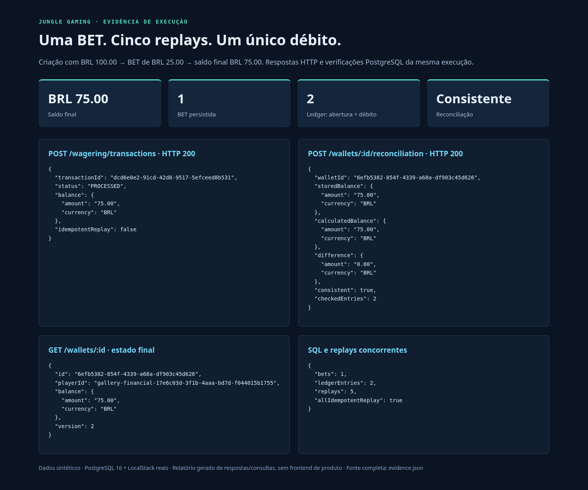
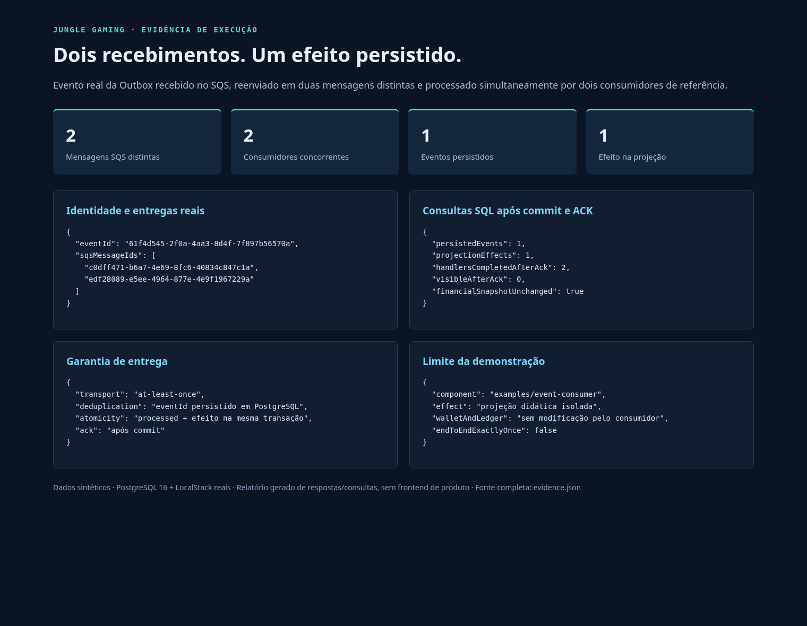
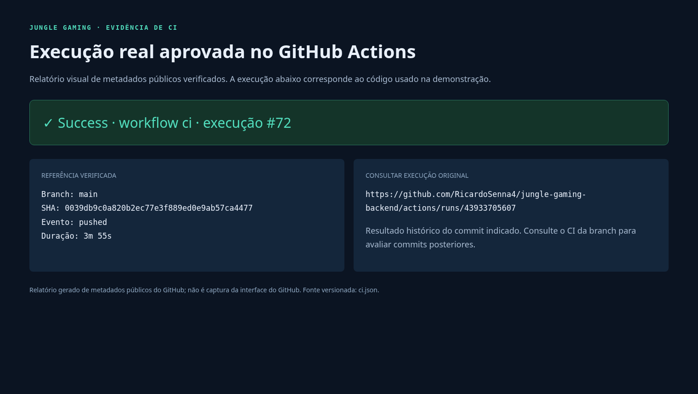

# Jungle Gaming Backend

[](https://www.typescriptlang.org/)
[](https://bun.sh/)
[](https://nestjs.com/)
[](https://www.postgresql.org/)
[](docker-compose.yml)
[](https://github.com/RicardoSenna4/jungle-gaming-backend/actions/workflows/ci.yml?query=branch%3Amain)

API REST e processador assíncrono de transações de apostas, desenvolvidos com TypeScript, NestJS e Bun para o desafio técnico da Jungle Gaming.

O projeto recebe `BET`, `WIN`, `LOSS`, `REFUND` e `ROLLBACK` por HTTP ou SQS FIFO. Possui wallets, ledger imutável, idempotência persistente, controle de concorrência por wallet, Inbox/Outbox, autenticação OIDC opcional, autorização por recurso, gestão de quarentena e observabilidade com Prometheus e Grafana.

O [enunciado original](CHALLENGE_SPEC.md) foi preservado. As decisões e os requisitos implementados estão documentados em [ARCHITECTURE.md](ARCHITECTURE.md) e na [rastreabilidade](docs/REQUIREMENTS_TRACEABILITY.md).

## Funcionalidades

- Criação de wallets por jogador e moeda, com crédito inicial registrado como `OPENING`.
- Processamento de `BET`, `WIN`, `LOSS`, `REFUND` e `ROLLBACK`.
- Valores monetários como strings decimais exatas com duas casas.
- Saldo não negativo e concorrência serializada por wallet no PostgreSQL.
- Idempotência por provedor, chave e payload canônico, com resposta original persistida.
- Ledger imutável, consulta paginada e reconciliação de saldo.
- Reversões com referência validada e processamento de referências fora de ordem.
- Inbox transacional e ACK SQS somente após commit.
- Outbox com leases, retry e eventos versionados com `eventId` estável.
- Autenticação JWT RS256 via OIDC/JWKS, mantendo o modo original do desafio.
- Vínculos persistentes de autorização e compartilhamento explícito de recursos entre provedores.
- Papéis e permissões administrativas para consulta, resolução e redrive de quarentena.
- Auditoria administrativa, logs JSON, health checks e métricas.
- Prometheus e Grafana opcionais, testes k6 e preparação AWS com Terraform.
- Testes reais com PostgreSQL, LocalStack e interrupção abrupta de processos.

## Tecnologias

| Tecnologia             |       Versão | Uso                                                      |
| ---------------------- | -----------: | -------------------------------------------------------- |
| TypeScript             |          5.x | Linguagem principal, com modo strict                     |
| Bun                    |       1.1.38 | Runtime, dependências e testes                           |
| NestJS                 |         10.x | API HTTP e injeção de dependências                       |
| MikroORM               |          6.x | Persistência e migrations                                |
| PostgreSQL             |           16 | Wallets, transações, ledger, Inbox, Outbox e autorização |
| AWS SDK for JavaScript |          3.x | Integração SQS                                           |
| LocalStack             |          3.8 | SQS FIFO e DLQ no ambiente local                         |
| Docker Compose         |           v2 | Execução da aplicação e dependências                     |
| Prometheus             |        3.2.1 | Coleta de métricas e avaliação de alertas                |
| Grafana                |       11.6.0 | Dashboard provisionado automaticamente                   |
| k6                     |       0.54.0 | Suíte independente de carga                              |
| Terraform              | 1.10+ e <2.0 | Infraestrutura AWS futura, validada estaticamente        |

As versões resolvidas das dependências estão no [lockfile](bun.lockb); imagens e ferramentas opcionais estão nos respectivos arquivos de infraestrutura.

<a id="projeto-em-funcionamento"></a>

## Demonstração

<a id="arquitetura"></a>

### Arquitetura do sistema



HTTP e SQS utilizam o mesmo caso de uso financeiro. Wallet, transação, ledger, Inbox e Outbox são persistidos de forma atômica quando aplicáveis. O publisher envia eventos após o commit, e o consumer confirma o ACK após persistir o processamento.

A entrega é **at-least-once**. Consumidores de eventos precisam deduplicar por `eventId`; o [consumidor de referência](examples/event-consumer/README.md) demonstra essa persistência em uma projeção isolada.

### Grafana: processamento e mensageria

A captura mostra métricas reais de throughput, duração, falhas, rejeições, DLQ, quarentena e pendências da Outbox. O tráfego inclui operações financeiras, rejeições esperadas por saldo insuficiente e um conflito de replay.

[](docs/gallery/grafana-live.png)

### Prometheus: coleta da API

O target `jungle-api` está em estado `UP`, com coleta em `api:3000/metrics`. A [consulta gravada](docs/gallery/prometheus-up.json) também confirmou `up=1` no momento da captura.

[](docs/gallery/prometheus-target.png)

### Operação financeira e reconciliação

Uma wallet criada com BRL `100.00` recebe uma BET de BRL `25.00`. Cinco replays concorrentes preservam uma única BET, dois lançamentos de ledger contando a abertura e saldo final BRL `75.00`. A reconciliação retorna diferença zero.

[](docs/gallery/financial-flow.png)

### Deduplicação persistente de eventos

Duas mensagens SQS distintas com o mesmo evento da Outbox são processadas por dois consumidores concorrentes. O PostgreSQL registra um evento e um efeito na projeção didática, sem modificar wallet ou ledger da aplicação principal.

[](docs/gallery/persistent-deduplication.png)

### CI aprovado e rastreável

O relatório abaixo corresponde à [execução #72](https://github.com/RicardoSenna4/jungle-gaming-backend/actions/runs/43933705607), aprovada no commit [`0039db9`](https://github.com/RicardoSenna4/jungle-gaming-backend/commit/0039db9c0a820b2ec77e3f889ed0e9ab57ca4477), usado na demonstração.

[](https://github.com/RicardoSenna4/jungle-gaming-backend/actions/runs/43933705607)

Grafana e Prometheus são capturas diretas. As outras três imagens são **relatórios visuais identificados**, gerados de respostas HTTP, consultas SQL e metadados públicos de CI. A demonstração usa dados sintéticos, PostgreSQL e LocalStack reais em ambiente descartável. Consulte [fontes, hashes, limites e reprodução](docs/gallery/README.md).

Essas imagens são registros históricos, sem afirmar capacidade de produção ou disponibilidade contínua. Para avaliar o código atual, confira o [CI da main](https://github.com/RicardoSenna4/jungle-gaming-backend/actions/workflows/ci.yml?query=branch%3Amain) no mesmo SHA do [último commit](https://github.com/RicardoSenna4/jungle-gaming-backend/commits/main). As [evidências anteriores](docs/CI_EVIDENCE.md) e as [capturas locais do Windows](docs/EXECUTION_EVIDENCE.md) permanecem disponíveis.

## Organização do código

```text
src/
├── domain/                  Money, Wallet, transações, ledger e eventos
├── application/             Casos de uso financeiros e serviços
│   ├── authorization/       Políticas de identidade e permissões
│   ├── quarantine/          Consulta, resolução e redrive
│   └── wallets/             Criação, consulta, ledger e reconciliação
├── infrastructure/
│   ├── database/            Entidades, repositórios e migrations MikroORM
│   ├── telemetry/           Métricas, logs e health checks
│   └── workers/             Consumer SQS, Outbox e referências pendentes
└── interfaces/http/         Controllers, DTOs, guards e autorização

test/                        Testes unitários e de integração
examples/event-consumer/      Consumidor didático com deduplicação persistente
performance/                 Suíte k6 e ambiente descartável
infra/                       LocalStack, observabilidade e Terraform
docs/                        Contratos, ADRs, evidências e guias operacionais
```

<a id="execução-rápida"></a>

## Como executar

### Pré-requisitos

- Docker Engine ou Docker Desktop com Docker Compose v2.
- Portas `3000`, `5432` e `4566` disponíveis.
- Bun 1.1.38 para executar a aplicação ou os testes fora do container, opcional no fluxo Docker.

### 1. Clonar o projeto

```bash
git clone https://github.com/RicardoSenna4/jungle-gaming-backend.git
cd jungle-gaming-backend
```

### 2. Iniciar a aplicação e as dependências

```bash
docker compose up --build -d
docker compose ps
```

Serviços iniciados:

| Serviço        | Endereço local                   |
| -------------- | -------------------------------- |
| API HTTP       | `http://localhost:3000`          |
| PostgreSQL     | `localhost:5432`, banco `jungle` |
| LocalStack/SQS | `http://localhost:4566`          |

A API aplica as migrations ao iniciar. O Compose padrão habilita consumer SQS, publisher Outbox e worker de referências pendentes. As credenciais fornecidas são apenas de desenvolvimento; o modo `challenge` deve ficar restrito ao ambiente local de avaliação.

### 3. Verificar a saúde dos serviços

```bash
curl http://localhost:3000/health/live
curl http://localhost:3000/health/ready
```

A readiness verifica PostgreSQL e as filas de comandos e eventos. O [guia de execução](docs/DEMO.md) contém orientações para PowerShell, WSL, Git Bash, Linux e macOS, além da alternativa com Bun no host.

### 4. Habilitar observabilidade opcional

```bash
ENABLE_DB_METRICS_SAMPLER=true docker compose --profile observability up -d
```

- Prometheus: `http://localhost:9090`.
- Grafana: `http://localhost:3001`, usuário `admin`.
- Senha local padrão: `local-development-only`; configure `GRAFANA_ADMIN_PASSWORD` para alterá-la.

Os coletores escutam em loopback. O dashboard e o datasource são provisionados automaticamente. Para OIDC, use o coletor autenticado descrito em [OBSERVABILITY.md](docs/OBSERVABILITY.md).

Para encerrar preservando os volumes:

```bash
docker compose --profile observability down
```

`down -v` remove os volumes do projeto e seus dados. Use essa opção somente em ambientes descartáveis.

## Configuração

As variáveis abaixo se referem ao processo da API. O Compose padrão define explicitamente o ambiente do desafio; para alterar autenticação, credenciais ou URLs no container, repasse as variáveis em um override de Compose. Para Bun no host, use [.env.example](.env.example) como referência.

| Variável                                      | Padrão ou exemplo local                                          | Descrição                                                                      |
| --------------------------------------------- | ---------------------------------------------------------------- | ------------------------------------------------------------------------------ |
| `PORT`                                        | `3000`                                                           | Porta HTTP                                                                     |
| `DB_HOST` / `DB_PORT`                         | `localhost` / `5432`                                             | Conexão PostgreSQL; Compose usa host `postgres`                                |
| `DB_NAME`                                     | `jungle`                                                         | Nome do banco                                                                  |
| `DB_USER` / `DB_PASSWORD`                     | `postgres` / `postgres`                                          | Credenciais locais de desenvolvimento                                          |
| `DB_SSL` / `DB_SSL_CA`                        | Desabilitado / não definido                                      | TLS com validação de certificado e CA confiável opcional                       |
| `AWS_REGION`                                  | `us-east-1`                                                      | Região SQS                                                                     |
| `SQS_ENDPOINT`                                | `http://localhost:4566` no ambiente local                        | Endpoint LocalStack; AWS real usa a credential chain do SDK sem override local |
| `SQS_QUEUE_URL`                               | `http://localhost:4566/000000000000/wager-transactions.fifo`     | Fila de comandos                                                               |
| `SQS_DLQ_QUEUE_URL`                           | `http://localhost:4566/000000000000/wager-transactions-dlq.fifo` | DLQ de falhas transitórias                                                     |
| `SQS_EVENTS_QUEUE_URL`                        | `http://localhost:4566/000000000000/wager-events.fifo`           | Fila de eventos da Outbox                                                      |
| `ENABLE_SQS_CONSUMER`                         | `false` no exemplo host / `true` no Compose                      | Habilita consumo de comandos                                                   |
| `ENABLE_OUTBOX_PUBLISHER`                     | `false` no exemplo host / `true` no Compose                      | Habilita publicação de eventos                                                 |
| `ENABLE_PENDING_REFERENCE_WORKER`             | `true` no exemplo e no Compose                                   | Reprocessa referências pendentes                                               |
| `OUTBOX_BATCH_SIZE` / `OUTBOX_LEASE_SECONDS`  | `20` / `60`                                                      | Tamanho do lote e duração da lease                                             |
| `AUTH_MODE`                                   | `challenge`                                                      | Use `oidc` para JWT e autorização por recurso                                  |
| `OIDC_ISSUER_URL` / `OIDC_AUDIENCE`           | Obrigatórios em OIDC                                             | Issuer confiável e audience esperada                                           |
| `OIDC_JWKS_URI`                               | Opcional                                                         | JWKS explícito ou descoberta OIDC validada                                     |
| `OIDC_PROVIDER_ID_CLAIM`                      | `providerId`                                                     | Claim de identidade do provedor                                                |
| `OIDC_ROLES_CLAIM` / `OIDC_PERMISSIONS_CLAIM` | `roles` / `scope`                                                | Claims operacionais verificadas                                                |
| `METRICS_ACCESS`                              | `auto`                                                           | OIDC autenticado; challenge local público; challenge em produção desabilitado  |
| `ENABLE_DB_METRICS_SAMPLER`                   | `false`                                                          | Amostra quarentena e Outbox para métricas                                      |

Parâmetros adicionais de timeout, cache, rotação e confiança de URLs estão em [OIDC_HARDENING.md](docs/OIDC_HARDENING.md). O provisionamento de identidades e grants segue [OIDC_ROLLOUT.md](docs/OIDC_ROLLOUT.md).

<a id="api-http"></a>

## Documentação da API

Os [contratos HTTP](docs/API.md) descrevem payloads, respostas, paginação e mensagens SQS. O [guia de uso](docs/DEMO.md) contém um fluxo completo com exemplos para diferentes terminais.

Money utiliza `{"amount":"25.00","currency":"BRL"}`: montante em string com duas casas e moeda de três letras maiúsculas. Os valores de `BET`, `WIN`, `LOSS`, `REFUND` e `ROLLBACK` devem ser positivos.

## Endpoints

As permissões abaixo se aplicam a `AUTH_MODE=oidc`. O modo `challenge` preserva o contrato permissivo do desafio.

### Wallets

| Método | Endpoint                            | Permissão em OIDC                                               | Descrição                            |
| ------ | ----------------------------------- | --------------------------------------------------------------- | ------------------------------------ |
| `POST` | `/wallets`                          | Grant de jogador/moeda; adicional para crédito inicial positivo | Cria wallet e registra abertura      |
| `GET`  | `/wallets/:walletId`                | `balance.read`                                                  | Consulta saldo e versão              |
| `GET`  | `/wallets/:walletId/ledger`         | `ledger.read_all`                                               | Consulta ledger paginado             |
| `POST` | `/wallets/:walletId/reconciliation` | `reconcile`                                                     | Compara saldo armazenado e calculado |

### Transações

| Método | Endpoint                                                              | Permissão em OIDC                     | Descrição                               |
| ------ | --------------------------------------------------------------------- | ------------------------------------- | --------------------------------------- |
| `POST` | `/wagering/transactions`                                              | `wager.submit`                        | Processa operação com `Idempotency-Key` |
| `GET`  | `/wagering/transactions/:transactionId`                               | Identidade e autorização da transação | Consulta por UUID                       |
| `GET`  | `/providers/:providerId/wagering/transactions/:externalTransactionId` | Identidade e autorização da transação | Consulta por identificador externo      |

### Quarentena

As operações exigem papel operacional aceito, permissão JWT e delegação persistida para a ação. A delegação administrativa atual é global explícita, conforme a [política administrativa](docs/ADMINISTRATIVE_ACCESS.md).

| Método | Endpoint                                                   | Permissão JWT        | Descrição                                                      |
| ------ | ---------------------------------------------------------- | -------------------- | -------------------------------------------------------------- |
| `GET`  | `/operations/quarantine`                                   | `quarantine:read`    | Consulta operacional compatível com o contrato anterior        |
| `GET`  | `/operations/quarantine/page`                              | `quarantine:read`    | Consulta com paginação e filtros                               |
| `GET`  | `/operations/quarantine/:consumerName/:messageId/redrives` | `quarantine:read`    | Histórico de redrives                                          |
| `POST` | `/operations/quarantine/:consumerName/:messageId/redrive`  | `quarantine:redrive` | Solicita reprocessamento com justificativa e chave idempotente |
| `POST` | `/operations/quarantine/:consumerName/:messageId/resolve`  | `quarantine:resolve` | Registra resolução administrativa                              |

Resolução e redrive são ações distintas. Consulte o [procedimento de recuperação](docs/QUARANTINE_RECOVERY.md).

### Saúde e métricas

| Método | Endpoint        | Acesso               | Descrição                                              |
| ------ | --------------- | -------------------- | ------------------------------------------------------ |
| `GET`  | `/health/live`  | Público              | Processo ativo                                         |
| `GET`  | `/health/ready` | Público              | Estado de PostgreSQL e filas                           |
| `GET`  | `/metrics`      | Política operacional | Métricas Prometheus; OIDC exige papel e `metrics:read` |

## Exemplos de uso

Os exemplos abaixo usam o modo local `challenge`. Substitua `<WALLET_ID>` pelo UUID retornado na criação. Em OIDC, envie também `Authorization: Bearer <ACCESS_TOKEN>`, com token emitido pelo IdP e grants previamente provisionados.

### Criar uma wallet

```bash
curl -X POST http://localhost:3000/wallets \
  -H "Content-Type: application/json" \
  -d '{
    "playerId": "demo-player-1",
    "initialBalance": {"amount":"100.00","currency":"BRL"}
  }'
```

Resposta ilustrativa `201 Created`:

```json
{
  "id": "11111111-1111-4111-8111-111111111111",
  "playerId": "demo-player-1",
  "balance": { "amount": "100.00", "currency": "BRL" },
  "version": 1
}
```

### Processar uma BET

```bash
curl -X POST http://localhost:3000/wagering/transactions \
  -H "Content-Type: application/json" \
  -H "Idempotency-Key: provider-a:bet-demo-1" \
  -d '{
    "providerId": "provider-a",
    "externalTransactionId": "bet-demo-1",
    "playerId": "demo-player-1",
    "walletId": "<WALLET_ID>",
    "roundId": "round-1",
    "gameId": "game-1",
    "kind": "BET",
    "money": {"amount":"25.00","currency":"BRL"}
  }'
```

Resposta ilustrativa `200 OK`:

```json
{
  "transactionId": "22222222-2222-4222-8222-222222222222",
  "status": "PROCESSED",
  "balance": { "amount": "75.00", "currency": "BRL" },
  "idempotentReplay": false
}
```

### Repetir uma operação com segurança

Reenvie a mesma BET com a mesma chave e o mesmo payload. A resposta preserva o `transactionId` e o saldo originalmente observado, com `idempotentReplay: true`. Nenhum novo débito é criado. Alterar o payload mantendo a chave retorna `409 IDEMPOTENCY_PAYLOAD_CONFLICT`.

### Consultar ledger e reconciliar

```bash
curl "http://localhost:3000/wallets/<WALLET_ID>/ledger?limit=50"
curl -X POST "http://localhost:3000/wallets/<WALLET_ID>/reconciliation"
```

A reconciliação retorna `storedBalance`, `calculatedBalance`, `difference`, `consistent` e `checkedEntries`. Uma divergência é sinalizada para investigação, sem correção automática de saldo.

### Reembolsar a BET

```bash
curl -X POST http://localhost:3000/wagering/transactions \
  -H "Content-Type: application/json" \
  -H "Idempotency-Key: provider-a:refund-demo-1" \
  -d '{
    "providerId": "provider-a",
    "externalTransactionId": "refund-demo-1",
    "playerId": "demo-player-1",
    "walletId": "<WALLET_ID>",
    "roundId": "round-1",
    "gameId": "game-1",
    "kind": "REFUND",
    "referenceExternalTransactionId": "bet-demo-1",
    "money": {"amount":"25.00","currency":"BRL"}
  }'
```

`REFUND` e `ROLLBACK` validam referência, tipo, valor integral e contexto financeiro. Referência ainda ausente pode produzir `PENDING_REFERENCE` / `202`, tratada pelo worker de referências pendentes.

## Segurança

- Modo `challenge` para compatibilidade com o enunciado, restrito ao ambiente local.
- Modo `oidc` fail-closed, com JWT RS256, issuer, audience, expiração e validação JWKS.
- Discovery e URLs JWKS validados, timeouts, cache e rotação por `kid`.
- Identidade autenticada vinculada a provedores e permissões persistidas no PostgreSQL.
- Autorização por recurso; UUID, body e `providerId` informado não concedem acesso.
- Wallets compartilháveis entre provedores explicitamente autorizados, sem propriedade exclusiva implícita.
- Papéis `operator` e `admin` configuráveis, com scopes por ação e delegação administrativa persistida.
- Métricas protegidas por política operacional e logs sem tokens completos.
- TLS PostgreSQL com validação de certificado quando habilitado.

Recursos legados não recebem grants automaticamente. Criar uma wallet não concede acesso futuro implícito por UUID. O modelo está descrito na [ADR-019](docs/adr/019-provider-resource-authorization.md).

## Tratamento de erros

Os contratos usam `errorCode` para falhas de domínio/autorização e respostas de validação do NestJS. Exemplo de conflito de idempotência:

```json
{
  "errorCode": "IDEMPOTENCY_PAYLOAD_CONFLICT"
}
```

| Status | Significado                                                  |
| -----: | ------------------------------------------------------------ |
|  `200` | Operação ou consulta concluída                               |
|  `201` | Recurso criado                                               |
|  `202` | Referência financeira pendente                               |
|  `400` | Payload inválido ou header obrigatório ausente               |
|  `401` | Token ausente, inválido ou expirado em OIDC                  |
|  `403` | Identidade sem vínculo ou permissão operacional insuficiente |
|  `404` | Recurso inexistente ou acesso ao recurso não autorizado      |
|  `409` | Conflito de idempotência, unicidade ou operação concorrente  |
|  `422` | Rejeição financeira, como saldo insuficiente                 |
|  `503` | Dependência ou configuração obrigatória indisponível         |

Os formatos completos e casos de retry estão nos [contratos HTTP](docs/API.md) e [testes HTTP](test/integration/http-api.spec.ts).

<a id="testes-críticos"></a>
<a id="testes-e-ci"></a>

## Testes

```bash
bun install --frozen-lockfile
bun run typecheck
bun run lint
bun run format:check
bun run build
# PostgreSQL, LocalStack e migrations precisam estar prontos em ambiente isolado:
bun run test:all
```

O runner obrigatório executa cada target e falha em caso de skips, ausência de testes ou falhas. O [workflow de CI](.github/workflows/ci.yml) inclui PostgreSQL e LocalStack reais, migrations, build Docker e smoke da aplicação em container.

| Cenário                                             | Resultado verificado                        | Evidência                                                                           |
| --------------------------------------------------- | ------------------------------------------- | ----------------------------------------------------------------------------------- |
| Duas BETs de 80.00 sobre saldo 100.00               | Uma processada, uma rejeitada e saldo 20.00 | [Concorrência](test/integration/concurrency.spec.ts)                                |
| 50 reenvios simultâneos                             | Um efeito financeiro e 49 replays           | [Concorrência](test/integration/concurrency.spec.ts)                                |
| Três processos sobre a mesma wallet                 | Saldo, versão e ledger consistentes         | [Multiprocessos](test/integration/concurrency.spec.ts)                              |
| Reversão antes da referência                        | Reprocessamento pelo worker                 | [Referências pendentes](test/integration/pending-worker.spec.ts)                    |
| SIGKILL após commit e antes de ACK                  | Redelivery sem novo efeito financeiro       | [Inbox](test/integration/inbox-commit-ack.spec.ts)                                  |
| SIGKILL após envio SQS e antes de marcar publicação | Recuperação da lease e mesmo eventId        | [Outbox](test/integration/outbox-publish-recovery.spec.ts)                          |
| Dois consumidores de eventos concorrentes           | Uma projeção persistida por eventId         | [Consumidor de referência](test/integration/reference-event-consumer.spec.ts)       |
| Acesso cruzado entre provedores                     | Recurso negado sem grant válido             | [Autorização financeira](test/integration/financial-resource-authorization.spec.ts) |

Reprodução, escopo das provas e execução segura estão em [TESTING.md](docs/TESTING.md). A suíte [k6](performance/README.md) é independente dos testes funcionais; os [resultados publicados](docs/PERFORMANCE_REPORT.md) descrevem somente o ensaio realmente realizado.

## Migrations

| Migration                                                                           | Descrição                                                            |
| ----------------------------------------------------------------------------------- | -------------------------------------------------------------------- |
| [20261113140000](src/infrastructure/database/migrations/Migration20261113140000.ts) | Metadados iniciais do serviço                                        |
| [20261113150000](src/infrastructure/database/migrations/Migration20261113150000.ts) | Wallets, transações, ledger, Inbox, Outbox e constraints financeiras |
| [20261114130000](src/infrastructure/database/migrations/Migration20261114130000.ts) | Referências pendentes e unicidade de reversões                       |
| [20261114140000](src/infrastructure/database/migrations/Migration20261114140000.ts) | Claim token e índices da Outbox                                      |
| [20261116110000](src/infrastructure/database/migrations/Migration20261116110000.ts) | Persistência de quarentena                                           |
| [20261116120000](src/infrastructure/database/migrations/Migration20261116120000.ts) | Vínculos de identidade, grants e auditoria de autorização            |
| [20261116130000](src/infrastructure/database/migrations/Migration20261116130000.ts) | Redrive, transições de status e auditoria operacional                |

```bash
bun run db:migrate
bun run db:migration:check
```

A execução fora do container exige configurar a conexão PostgreSQL. Rollbacks de autorização/quarentena têm exigências de backup e confirmação; siga a [ADR](docs/adr/019-provider-resource-authorization.md) e o [procedimento operacional](docs/QUARANTINE_RECOVERY.md). Não execute rollback em dados reais para testar a aplicação.

<a id="matriz-de-avaliação"></a>

## Requisitos do desafio

| Critério            | Peso oficial | Referência                               |
| ------------------- | -----------: | ---------------------------------------- |
| Correção financeira |           20 | Money, wallet e ledger                   |
| Concorrência        |           20 | Locks por wallet e testes multiprocessos |
| Idempotência        |           15 | Chave persistida, hash canônico e replay |
| Mensageria e falhas |           15 | Inbox, Outbox, quarentena e DLQ          |
| Arquitetura         |           10 | Domínio, aplicação e infraestrutura      |
| Testes              |           10 | Runner obrigatório e CI                  |
| Observabilidade     |            5 | Logs, métricas e health checks           |
| Documentação        |            5 | Contratos, guias, ADRs e evidências      |

Os pesos são os do enunciado, sem pontuação autoatribuída. A [matriz de rastreabilidade](docs/REQUIREMENTS_TRACEABILITY.md) liga os requisitos à implementação e aos testes.

<a id="documentação"></a>
<a id="decisões-e-limitações"></a>

## Documentação e implantação

- [Arquitetura](ARCHITECTURE.md), [ADRs](docs/02_ADR_REGISTER.md) e [índice de ADRs](docs/adr/README.md).
- [Contratos HTTP e SQS](docs/API.md) e [guia de execução](docs/DEMO.md).
- [Galeria e reprodução](docs/gallery/README.md), [evidências Windows](docs/EXECUTION_EVIDENCE.md) e [evidências de CI](docs/CI_EVIDENCE.md).
- [Recuperação de falhas](docs/FAILURE_RECOVERY.md), [quarentena](docs/QUARANTINE_RECOVERY.md), [Inbox](docs/INBOX_COMMIT_ACK_RECOVERY.md) e [Outbox](docs/OUTBOX_PUBLISH_RECOVERY.md).
- [Hardening OIDC](docs/OIDC_HARDENING.md), [acesso administrativo](docs/ADMINISTRATIVE_ACCESS.md) e [rollout de identidades](docs/OIDC_ROLLOUT.md).
- [Prometheus e Grafana](docs/OBSERVABILITY.md), [carga k6](performance/README.md) e [relatório de desempenho](docs/PERFORMANCE_REPORT.md).
- [Terraform AWS](infra/terraform/README.md), [limitações](docs/OPEN_ISSUES.md), [checklist](docs/DELIVERY_CHECKLIST.md) e [auditoria de entrega](docs/FINAL_DELIVERY_AUDIT.md).

O ambiente de desenvolvimento usa Compose e LocalStack. O Terraform prepara uma implantação futura com ECS/Fargate, RDS, SQS, IAM e TLS; foi validado estaticamente, sem `apply` nem recursos pagos. IdP externo, implantação AWS, restauração em conta real e entrega externa de alertas exigem validação operacional própria.

## Licença

A licença de uso ainda não está definida em um arquivo `LICENSE` neste repositório.

## Autor

**Ricardo Senna**

[GitHub](https://github.com/RicardoSenna4) · [Repositório](https://github.com/RicardoSenna4/jungle-gaming-backend)
