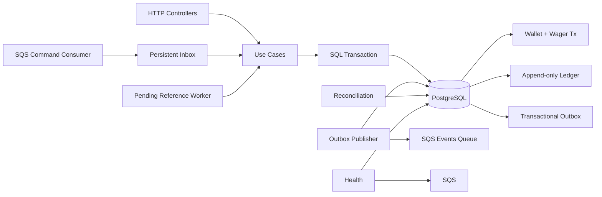

# Plano arquitetural — Jungle Gaming Backend Challenge

**Status:** PROPOSTO para implementação após aprovação da Fase 0. Esta tarefa não implementa código.

## 1. Princípios

A solução será um monólito modular NestJS, executável em múltiplos processos/roles. O PostgreSQL será a fonte de verdade para saldo, ledger, idempotência, inbox e outbox. SQS FIFO, caches e locks em memória serão apenas otimizações. O domínio não dependerá de NestJS, MikroORM ou AWS.

A prioridade é correção financeira sob at-least-once delivery, concorrência, mensagens fora de ordem, crash e indisponibilidade transitória. A autenticação própria não será implementada, pois não pontua; haverá um ponto de extensão para validação por IdP OIDC externo.

## 2. Organização NestJS/DDD

```text
src/
  domain/
    money/                 # Money, erros e regras decimais
    wallet/                # Wallet aggregate e invariantes
    wagering/              # WagerTransaction, estados e policies
    ledger/                # WalletLedgerEntry imutável
    messaging/             # InboxMessage e OutboxMessage
    events/                # envelope abstrato e eventos concretos
  application/
    ports/                 # interfaces de persistência, clock, bus e identidade
    use-cases/             # create wallet, submit, pending, queries, reconciliation
    services/              # hash canônico, classificação de erros
  infrastructure/
    database/mikro-orm/    # entidades, adapters, migrations e transações
    messaging/sqs/         # client, consumer, DLQ e publisher
    workers/               # pending-reference, outbox e reconciliation
    telemetry/             # logs, métricas e health indicators
  interfaces/
    http/                  # controllers, DTOs, filters e auth guard
    sqs/                   # schemas de mensagens
  app.module.ts
  main.ts
```

`domain` não importa framework. `application` usa somente ports e domínio. `infrastructure` implementa ports. HTTP e SQS validam boundaries e chamam o mesmo `SubmitWagerUseCase`; não duplicam regra financeira.

## 3. Componentes e filas



A fila de comandos será `wager-transactions.fifo`, com `wager-transactions-dlq.fifo`. Eventos publicados usarão fila separada, por exemplo `wager-events.fifo`, para não retornar ao consumidor de comandos.

## 4. Money e Wallet

`Money` será classe imutável com construtor privado, `from`, `zero` e rehydrate/factory interna. Entrada externa aceita apenas string canônica com duas casas e currency ISO-4217. A aritmética usará `decimal.js` ou equivalente, nunca `number`. PostgreSQL persistirá `NUMERIC(20,2)` e o adapter converterá explicitamente entre string e Money.

`Wallet` é o aggregate root da concorrência: `id`, `playerId`, `currency`, `balance`, `version`, timestamps. Invariantes: unicidade `(playerId,currency)`, saldo não negativo no domínio e SQL, versão inicial 1, incremento somente em mudança de saldo e moeda imutável. O aggregate calcula a transição; o use case persiste wallet e ledger na mesma transação.

## 5. Ledger

`wallet_ledger_entries` terá `id`, `walletId`, `transactionId`, `direction`, `amount`, `currency`, `balanceBefore`, `balanceAfter` e `createdAt`. Haverá `UNIQUE(wallet_id, transaction_id)`, checks de valor e saldo, foreign keys e trigger PostgreSQL que bloqueia UPDATE/DELETE. A factory verifica `before +/- amount == after`. `LOSS`, rejeições e operações sem movimento não criam entrada.

A reconciliação abrirá snapshot consistente, somará créditos menos débitos em decimal e retornará stored/calculated/difference/consistent/checkedEntries. Divergência será sinalizada; nunca haverá autocorreção silenciosa.

## 6. Idempotência

HTTP exige `Idempotency-Key`. A operação terá unicidade por provider/key e por provider/externalTransactionId. O hash será SHA-256 de JSON canônico com chaves recursivamente ordenadas e estes campos de negócio: externalTransactionId, gameId, kind, money, playerId, providerId, referenceExternalTransactionId normalizado, roundId e walletId. Header, messageId, correlationId e metadados de transporte ficam fora.

A primeira execução persiste `responseSnapshot`, incluindo transactionId, status, failureCode e saldo observado. Replay idêntico não movimenta saldo e retorna o snapshot original com `idempotentReplay=true`. Hash divergente retorna `409 IDEMPOTENCY_CONFLICT`.

SQS usa inbox persistente por `(consumerName,messageId)` e payload hash. Redelivery encontra a inbox/idempotência já confirmada e não repete efeito.

## 7. Concorrência e transação única

Escolha: `SELECT ... FOR UPDATE` na wallet dentro da transação PostgreSQL. A ordem será determinística: claim/consulta da identidade, locks de referência necessários, lock da wallet, validação sob lock, mudança, ledger, outbox e commit. Wallets diferentes progridem em paralelo; não existe lock global. Deadlocks/serialization failures terão retry limitado e seguro.

```text
BEGIN
  claim idempotency key / inbox
  lock reference and wallet in fixed order
  validate context, kind, amount and balance
  insert wager transaction
  update wallet only when balance changes
  insert at most one ledger row
  insert integration event(s) in outbox
  mark inbox processed when SQS
  persist response snapshot/status
COMMIT
HTTP response or SQS ACK only after COMMIT
```

Falha de negócio persiste REJECTED com failureCode e evento, mas sem ledger. Falha de infraestrutura antes do commit faz rollback. Publicação SQS ocorre somente fora da transação.

## 8. Fluxos de negócio

- **BET:** valor positivo; lock wallet; saldo suficiente → débito, DEBIT, version + 1, Processed e BalanceChanged. Insuficiência → REJECTED/`INSUFFICIENT_FUNDS`, sem movimento.
- **WIN:** crédito positivo; referência a BET é opcional conforme decisão; CREDIT, version + 1 e eventos.
- **LOSS:** registra resultado como Processed; não altera saldo, versão ou ledger.
- **REFUND:** referência externa obrigatória; mesma provider/player/wallet/currency/round; referência BET processada; valor integral; uma reversão. Credita e gera CREDIT.
- **ROLLBACK:** referencia BET/WIN/REFUND processada, no mesmo contexto e valor integral; inverte a direção. Rollback de crédito pode ser REJECTED/`REVERSAL_INSUFFICIENT_FUNDS`.

A política conservadora proíbe segunda reversão econômica direta da mesma referência, ainda que o tipo seja diferente, salvo cadeia explicitamente modelada.

## 9. Referências fora de ordem

REFUND/ROLLBACK sem referência disponível nasce `PENDING_REFERENCE` e gera `WagerTransactionPendingReference`. Worker periódico usa lease, backoff exponencial, limite de tentativas e TTL. Referência encontrada e processada permite continuar pelo mesmo use case. Referência ausente até TTL gera `REJECTED/REFERENCE_NOT_FOUND` e evento. Contexto inválido, tipo inválido ou referência rejeitada geram failureCode de regra. Falha de banco não vira rejeição de negócio.

## 10. Contratos HTTP e errors

| Condição | HTTP | Código |
|---|---:|---|
| Wallet criada | 201 | — |
| Processada ou replay | 200 | — |
| Referência pendente | 202 | `PENDING_REFERENCE` |
| Payload inválido | 400 | `INVALID_PAYLOAD` |
| Key/payload divergente ou duplicidade | 409 | `IDEMPOTENCY_CONFLICT` |
| Rejeição de domínio | 422 | `INSUFFICIENT_FUNDS`, `AMOUNT_MISMATCH`, etc. |
| Recurso inexistente | 404 | `WALLET_NOT_FOUND`/`TRANSACTION_NOT_FOUND` |
| Infra transitória | 503 | `INFRASTRUCTURE_RETRYABLE` |

Failure codes mínimos: `INSUFFICIENT_FUNDS`, `REVERSAL_INSUFFICIENT_FUNDS`, `REFERENCE_NOT_FOUND`, `REFERENCE_NOT_PROCESSED`, `REFERENCE_CONTEXT_MISMATCH`, `INVALID_REFERENCE_KIND`, `REVERSAL_ALREADY_APPLIED`, `AMOUNT_MISMATCH`, `WALLET_NOT_FOUND`, `WALLET_CONTEXT_MISMATCH`, `CURRENCY_MISMATCH`, `INVALID_OPERATION`, `INFRASTRUCTURE_EXHAUSTED`.

Rotas: `POST /wallets`, `GET /wallets/:walletId`, `GET /wallets/:walletId/ledger`, `GET /wagering/transactions/:transactionId`, `GET /providers/:providerId/wagering/transactions/:externalTransactionId`, `POST /wagering/transactions`, `POST /wallets/:walletId/reconciliation`, `GET /health/live` e `GET /health/ready`.

## 11. Inbox, outbox e eventos

Inbox, wallet, transaction, ledger e outbox confirmam atomicamente. ACK SQS ocorre após commit; negócio terminal é ACK, infra transitória não é ACK, payload permanente segue DLQ/quarentena. SIGTERM para polling e drena mensagens ou deixa redelivery seguro.

Outbox contém eventId, aggregateId, eventType, payload JSONB, occurredAt, attempts, nextAttemptAt, lease e publishedAt. Publisher reclama itens due com `FOR UPDATE SKIP LOCKED`, publica fora da transação e marca published após sucesso. Crash após publicação pode duplicar eventId; consumidores precisam deduplicar.

Eventos concretos e versionados: `WagerTransactionProcessed` (inclui LOSS), `WagerTransactionRejected`, `WagerTransactionPendingReference` e `WalletBalanceChanged` somente quando o saldo muda. Payloads usam MoneyProps string.

## 12. Observabilidade, health e auth

Logs JSON terão correlationId, messageId, transactionId, walletId, providerId, status e duração, sem payload financeiro completo ou secrets. Métricas: status/kind, duplicatas, retries, DLQ, lock conflicts, outbox lag, pending references, divergências e latência.

`/health/live` testa somente o processo. `/health/ready` testa PostgreSQL e SQS. Ambos ficam abertos. Autenticação será deixada para IdP OIDC externo via `ProviderIdentityPort`/guard; não haverá tabela ou hash de senha próprio.

## 13. Modelo lógico

```text
wallets(id PK, player_id, currency, balance NUMERIC(20,2), version,
        created_at, updated_at, UNIQUE(player_id,currency), CHECK balance>=0)
wager_transactions(id PK, provider_id, external_transaction_id,
        idempotency_key, payload_hash, wallet_id FK, player_id, round_id,
        game_id, kind, amount NUMERIC(20,2), currency, status,
        reference_external_transaction_id, reference_transaction_id,
        failure_code, response_snapshot, created_at, processed_at,
        UNIQUE(provider_id,external_transaction_id),
        UNIQUE(provider_id,idempotency_key))
wallet_ledger_entries(id PK, wallet_id FK, transaction_id FK, direction,
        amount, currency, balance_before, balance_after, created_at,
        UNIQUE(wallet_id,transaction_id), append-only trigger)
inbox_messages(consumer_name, message_id, payload_hash, received_at,
        processed_at, PRIMARY KEY(consumer_name,message_id))
outbox_messages(id PK, aggregate_id, event_type, payload JSONB,
        occurred_at, attempts, next_attempt_at, claimed_until, published_at)
pending_reference_jobs(transaction_id FK, attempts, next_attempt_at,
        expires_at, claimed_until)
```

## 14. Testes e dependências

Unidade: Money, Wallet, estados terminais, Ledger, hash, policies, errors e eventos. Integração real: migrations, constraints, append-only, OPENING, rollback transacional, inbox, SQS/DLQ, outbox, health, reconciliation e cursor. Concorrência real: BET x50, duas BET 80, wallets independentes, três processos, crash pós-commit/pré-ACK, publishers concorrentes, referência fora de ordem e restart.

```text
Fase 1 Fundação (Bun/Nest/Compose/PG/SQS/scripts)
 -> Fase 2 Domínio + SQL + migrations
 -> Fase 3 HTTP + locking + idempotência
 -> gate C01/C02
 -> Fase 4 reversões + pending reference
 -> Fase 5 inbox/SQS/DLQ/shutdown
 -> Fase 6 eventos/outbox/publisher
 -> Fase 7 3 instâncias/reconciliation/paginação
 -> Fase 8 observabilidade/security/CI
 -> Fase 9 entrega
```

Nenhuma fase posterior ao HTTP deve começar se C01/C02 falhar. Cada fase exige comando, exit code, ambiente, serviços reais, commit e atualização do progresso.

## 15. Trade-offs

Monólito modular foi escolhido em vez de microserviços para reduzir superfície de falha. MikroORM é preferido pelo enunciado e explicita Unit of Work/EntityManager transacional, embora exija disciplina com Identity Map. Row locking é previsível para hot wallet e restringe contenção à wallet, com custo de espera. PostgreSQL, não FIFO ou cache, fornece garantias duráveis. Outbox at-least-once é honesta: exactly-once entre DB e SQS não é garantível, então eventId e consumidores idempotentes são obrigatórios. Fila de eventos separada evita loops, ao custo de mais configuração.
