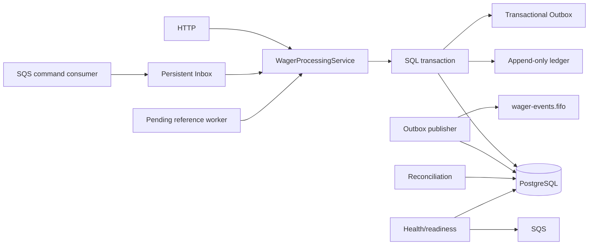

# Plano arquitetural — Jungle Gaming Backend Challenge

**Status da execução:** base funcional implementada, com revisões incrementais em 2026-11-14. Este documento mantém o desenho original e a matriz de estado atual; fases marcadas como implementadas referem-se ao código, não necessariamente a gates de infraestrutura reexecutados nesta sessão.

## 1. Princípios

A solução é um monólito modular NestJS, executável com múltiplos processos/roles. PostgreSQL é a fonte da verdade para saldo, ledger, idempotência, Inbox e Outbox. SQS FIFO é transporte at-least-once; a consistência não depende de cache ou da deduplicação do broker.

A prioridade é correção financeira sob duplicidade, concorrência, mensagem fora de ordem, crash e indisponibilidade transitória. Autenticação própria não foi implementada, pois não pontua no desafio; uma integração futura deve usar IdP OIDC, sem tabela artesanal de senhas.

## 2. Organização NestJS/DDD

```text
src/
  domain/                    # Money, wallet, wagering, ledger, inbox/outbox e eventos
  application/               # casos de uso financeiros e serviços de wallet
  infrastructure/database/  # entidades MikroORM, migrations e transações
  infrastructure/workers/   # consumer, publisher outbox e pending-reference
  infrastructure/telemetry/ # health checks e métricas Prometheus
  interfaces/http/           # controllers HTTP
  app.module.ts
  main.ts
```

MikroORM é o único ORM ativo. HTTP, SQS e worker de referências chamam o mesmo `WagerProcessingService`. Migrations SQL são versionadas e reversíveis.

## 3. Componentes e filas



As filas são `wager-transactions.fifo`, `wager-transactions-dlq.fifo` e `wager-events.fifo`. O publisher não retorna eventos à fila de comandos.

## 4. Money, wallet e ledger

`Money` é imutável; a representação externa usa strings decimais canônicas com duas casas e currency. PostgreSQL persiste `NUMERIC(20,2)`. Wallet tem unicidade `(playerId,currency)`, saldo não negativo, versão e lock pessimista por linha. Cada alteração de saldo e seu lançamento no ledger confirmam na mesma transação.

O ledger tem unicidade por wallet/transação, checagem de consistência aritmética de cada linha e trigger que bloqueia UPDATE/DELETE. `LOSS`, rejeições e operações sem movimento não criam lançamento.

## 5. Idempotência e concorrência

A API exige `Idempotency-Key`. O payload canônico de negócio é hasheado em SHA-256; header e metadados de transporte ficam fora. A primeira execução guarda `responseSnapshot`; replay idêntico retorna o snapshot original, e hash divergente retorna conflito.

A operação bloqueia a wallet com `SELECT FOR UPDATE`, restringindo concorrência ao agregado. Constraints SQL resolvem disputas simultâneas de chaves externas e reversões. Replays e erros transitórios têm classificação própria; retries são limitados no caso de uso.

## 6. Reversões e referências fora de ordem

BET, WIN, LOSS, REFUND e ROLLBACK são processados pelo caso de uso único. Refund e rollback validam provider, player, wallet, moeda, rodada, tipo da referência e valor integral. A unicidade da referência evita reversão duplicada. Uma referência ausente é persistida como `PENDING_REFERENCE`; o worker periódico reprocessa com backoff e TTL/limite configurados.

## 7. Inbox, consumer e shutdown

Inbox, transação, ledger, alteração da wallet e eventos outbox confirmam atomicamente. O consumer de comandos reutiliza o mesmo caso de uso HTTP, dá ACK somente depois do commit e deixa mensagens não confirmáveis para redrive via política da fila. `enableShutdownHooks()` permite interromper polling e aguardar trabalho em andamento.

## 8. Outbox e entrega de eventos

O publisher seleciona eventos vencidos com `FOR UPDATE SKIP LOCKED`, grava um token/lease em transação curta, publica fora da transação e marca o evento após sucesso. Em falha, libera o claim e agenda backoff exponencial com teto de cinco minutos. Um crash entre envio e marcação pode causar redelivery; os envelopes incluem `eventId` e a garantia é at-least-once, não exactly-once.

## 9. HTTP, health e observabilidade

Rotas atuais incluem criação/consulta de wallet, ledger paginado, reconciliação, submissão e consultas de transação. `/health/live` verifica processo; `/health/ready` verifica PostgreSQL e filas SQS. `/metrics` expõe métricas Prometheus por instância: processamento por origem/status/tipo, replay idempotente, retry, conflito de lock, SQS recebido/ack/não-ack/DLQ, lag/backlog da outbox e latência. Logs JSON evitam payload monetário.

## 10. Estado das fases

| Fase | Escopo | Estado no código |
|---|---|---|
| 1 | Bun, NestJS, Compose, PostgreSQL e LocalStack | Implementada |
| 2 | Domínio, schema e migrations MikroORM | Implementada |
| 3 | HTTP, locking, idempotência e ledger | Implementada |
| 4 | REFUND/ROLLBACK e referências pendentes | Implementada |
| 5 | Inbox, SQS FIFO, redrive e shutdown | Implementada; teste real depende de LocalStack |
| 6 | Eventos, transactional outbox e publisher | Implementada; três testes PostgreSQL reais passaram |
| 7 | Concorrência, cursor e reconciliação | Implementada; concorrência real e detecção de divergência passaram |
| 8 | Health, métricas, logs, CI e auth | Health/métricas/logs implementados; auth deliberadamente não implementada |
| 9 | Verificação, documentação e entrega | Em validação contínua |

## 11. Gates verificados nesta sessão

- Bun 1.1.38 instalado; `bun install --frozen-lockfile` passou em instalação limpa. AJV 8 direto mantém o CLI de migrations funcional.
- `bun run typecheck`, `bun run lint`, `bun run format:check`, `bun run build` e `bun run test:unit`: aprovados; 30 testes unitários passaram.
- PostgreSQL 16 local: quatro migrations aplicadas; `db:migration:check` sem pendências; 25 testes de integração aprovados, incluindo concorrência do publisher e reconciliação.
- O teste end-to-end LocalStack foi pulado; Docker/LocalStack não estão disponíveis neste sandbox. Esse único gate externo permanece pendente.
