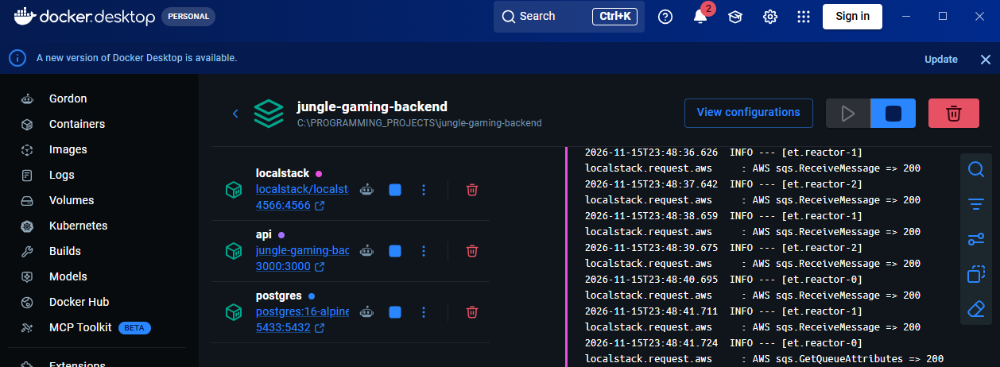
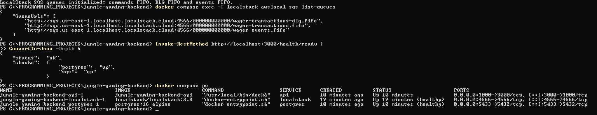
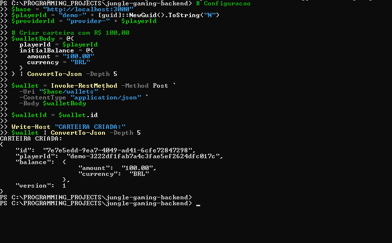
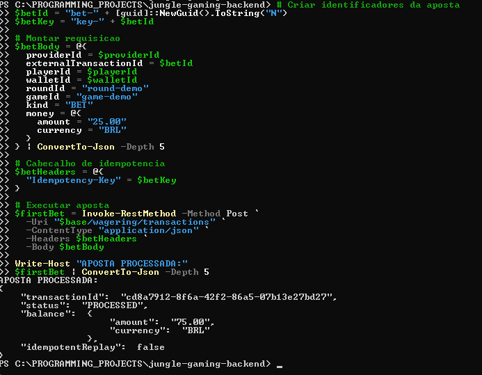
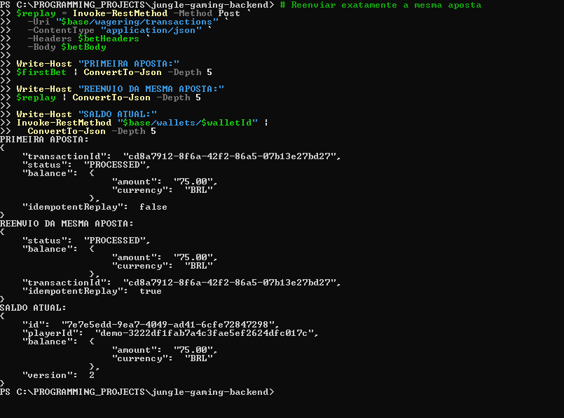
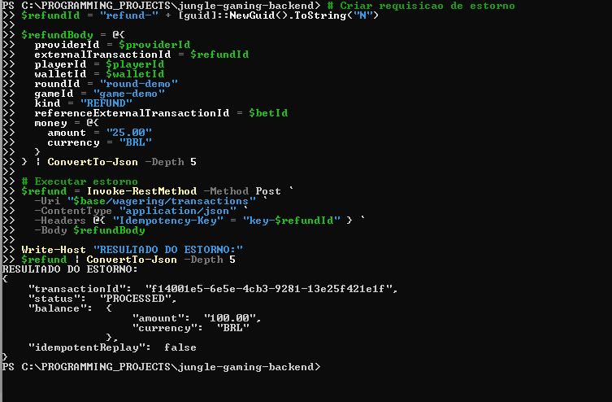
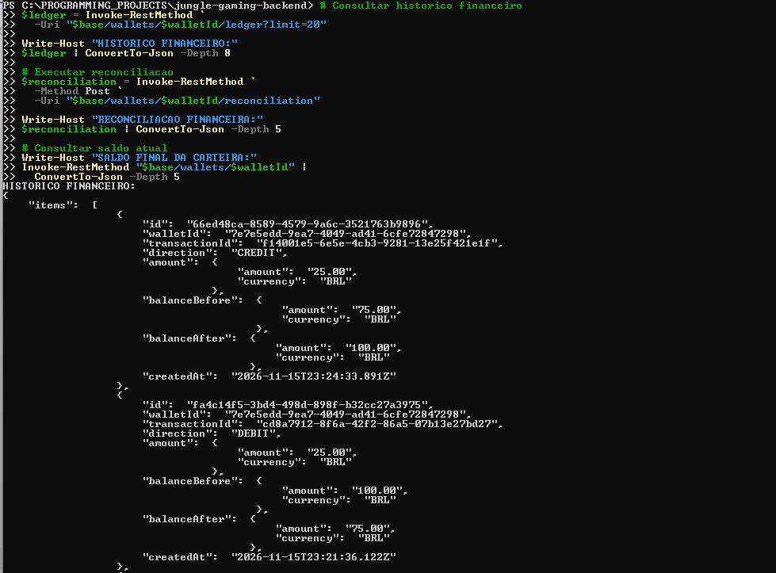
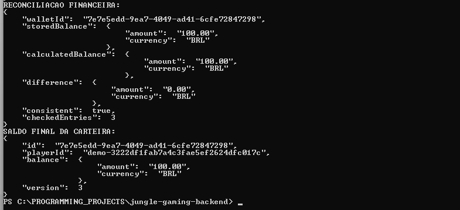
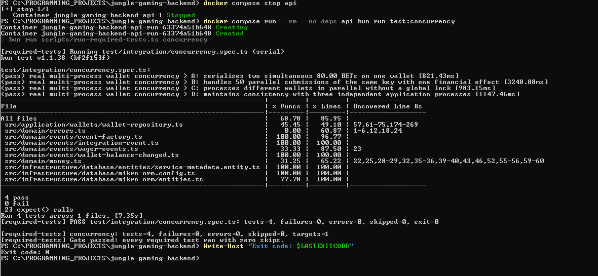

# Evidências de execução local — Windows / PowerShell

Estas evidências documentam **capturas reais fornecidas em 15/11/2026**, realizadas no Windows com Docker Desktop e PowerShell. Os prints foram registrados pelo responsável pelo projeto, não gerados artificialmente.

**O que comprovam:** execução local do ambiente, contrato HTTP, saldos, idempotência, estorno, reconciliação e resultado dos testes de concorrência. **O que não comprovam por si só:** qual SHA estava no checkout local, AWS gerenciado ou todos os possíveis pontos de falha de Inbox/Outbox. Para verificar o CI do commit efetivamente entregue, consulte [CI_EVIDENCE.md](CI_EVIDENCE.md). O tutorial para reproduzir os testes está em [DEMO.md](DEMO.md).

## 1. Docker Desktop: API, PostgreSQL e LocalStack



O Docker Desktop exibe os serviços `api` (porta 3000), `postgres` (5432) e `localstack` (4566) em execução.

### Filas SQS e readiness



A consulta `awslocal sqs list-queues` mostra `wager-transactions.fifo`, `wager-transactions-dlq.fifo` e `wager-events.fifo`. A rota `/health/ready` responde `status: ok`, `postgres: up` e `sqs: up`. `docker compose ps` confirma os serviços.

## 2. Operações financeiras e idempotência

### Criação da wallet: R$ 100,00



O endpoint `POST /wallets` devolve um `walletId`, saldo inicial `100.00 BRL` e versão `1`.

### BET: débito de R$ 25,00



A primeira operação retorna `PROCESSED` e `idempotentReplay: false`; o saldo passa de `100.00` a `75.00 BRL`.

### Reenvio idempotente: nenhum segundo débito



A repetição do mesmo payload e da mesma `Idempotency-Key` devolve o mesmo `transactionId`, `idempotentReplay: true` e o saldo original da resposta, `75.00 BRL`. A consulta da wallet também indica `75.00 BRL` e versão `2`.

### REFUND: estorno integral de R$ 25,00



O estorno referencia a BET, é `PROCESSED` e restaura o saldo a `100.00 BRL`.

## 3. Ledger e reconciliação

### Histórico financeiro (parte 1)



Os lançamentos visíveis incluem `DEBIT` de `25.00 BRL` e `CREDIT` de `25.00 BRL`, com os saldos antes e depois.

### Reconciliação (parte 2)



A resposta registra `storedBalance: 100.00 BRL`, `calculatedBalance: 100.00 BRL`, `difference: 0.00 BRL`, `consistent: true` e `checkedEntries: 3`. A wallet retorna versão `3`.

## 4. Testes de concorrência reais em Compose



Comandos exibidos no PowerShell:

```powershell
docker compose stop api
docker compose run --rm --no-deps api bun run test:concurrency
Write-Host "Exit code: $LASTEXITCODE"
```

O runner registra **4 pass, 0 fail, exit code 0** para os cenários **A** (duas BETs de `80.00` disputando uma wallet), **B** (50 submissões paralelas da mesma chave), **C** (wallets distintas sem lock global) e **D** (contenção com ≥3 processos). O print mostra a **aprovação dos testes**, não o estado SQL detalhado de cada cenário. Para inspecionar as asserções, consulte [concurrency.spec.ts](../test/integration/concurrency.spec.ts).

Depois de `docker compose stop api`, execute `docker compose up -d api` para reativar os endpoints.

## Resumo de evidências

| Cenário | Resultado observado | Captura |
|---|---|---|
| Infraestrutura | 3 serviços Docker e 3 filas SQS FIFO/DLQ | [01](evidence/01-docker-compose.png) · [02](evidence/02-health-and-sqs.png) |
| Wallet | Saldo inicial `100.00 BRL` | [03](evidence/03-wallet-created.png) |
| BET | `PROCESSED`, saldo `75.00 BRL` | [04](evidence/04-bet-processed.png) |
| Idempotência | Mesmo ID, replay verdadeiro, sem segundo débito | [05](evidence/05-idempotent-replay.png) |
| REFUND | Estorno integral, saldo `100.00 BRL` | [06](evidence/06-refund-processed.png) |
| Ledger | Débito e crédito rastreáveis | [07](evidence/07-ledger-history.png) |
| Reconciliação | `consistent: true`, diferença `0.00`, três lançamentos | [08](evidence/08-reconciliation.png) |
| Concorrência | 4 testes aprovados, 0 falhas, exit code 0 | [09](evidence/09-concurrency-test.png) |

**Rastreabilidade:** nenhuma captura inclui a saída de `git rev-parse HEAD`. A data e a execução local podem ser verificadas nos prints, mas não é correto atribuir essas capturas a um SHA específico. O [CI por SHA](CI_EVIDENCE.md) cobre o código versionado, e [DEMO.md](DEMO.md) permite repetir o fluxo em qualquer computador.
