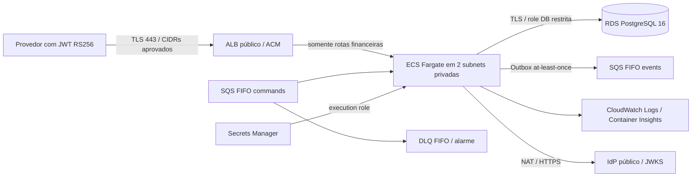

# Implantação AWS futura

Este código prepara uma implantação; nenhum recurso AWS foi criado. O Compose e
LocalStack continuam sendo o caminho de desenvolvimento e avaliação. Aplicar esta
infraestrutura gera custos de NAT, ALB, Fargate, RDS e monitoramento. Não execute
apply sem aprovação explícita, revisão do plano e da conta de destino.

## Arquitetura e escolha

Fargate dispensa administrar hosts, suporta réplicas stateless e substituição de
tasks com circuit breaker. Wallet locks, Inbox, Outbox e grants permanecem no
PostgreSQL; nenhuma exclusão mútua local sustenta a correção financeira.

`network` cria VPC, duas AZs, subnets e NAT. Dev usa um NAT; staging/prod usam um
por AZ. `data` cria RDS privado, TLS obrigatório, storage criptografado, backup
PITR de 7/35 dias, snapshot final e deletion protection, além de SQS com SSE e
negação de transporte inseguro. `runtime` cria ALB TLS1.2/1.3, tasks privadas,
IAM separado, logs, health checks, autoscaling CPU60% e rollback automático de
deployment. TLS termina no ALB; tráfego ALB→task HTTP fica limitado por SG.

## Preparação por ambiente

1. Use conta/estado separados para dev, staging e prod. Copie o exemplo correspondente
   de environments/ para um arquivo protegido fora do Git. Exemplos usam conta
   fictícia, IP de documentação, IdP `.invalid` e digest inexistente.
2. Configure backend remoto S3 criptografado, versionado, com locking, políticas de
   menor privilégio e logs de acesso. Nenhum backend real está incluído. Estado e
   planos nunca entram no Git. Trabalhe com credenciais temporárias, sem perfil de
   produção no ambiente de desenvolvimento.
3. Publique imagem ECR auditada por digest; informe ARN do repositório. Provisionar
   ACM e DNS para nome de domínio compatível com o certificado e apontá-lo ao ALB.
   O output do ALB é um destino DNS, não um nome coberto automaticamente pelo ACM.
4. Prepare IdP HTTPS com issuer/audience reais e claims/grants aprovados conforme
   [rollout OIDC](../../docs/OIDC_ROLLOUT.md). Nenhum token válido ganha grants
   automaticamente. O exemplo não configura IdP, identidades ou vínculos legados.
5. Faça bootstrap do RDS em execução administrativa privada, com acesso temporário
   ao master secret gerenciado pelo RDS. Crie banco/roles de migration e runtime
   separados. Runtime não deve receber master nem DDL: conceda apenas tabelas,
   sequences e operações necessárias. Popule secret JSON `username,password` da
   aplicação no Secrets Manager; configure um secret string com bundle PEM RDS
   confiável. Terraform referencia ARNs, sem gravar os valores em variáveis/estado.
   Secrets com KMS gerenciado pelo cliente exigem extensão explícita de kms:Decrypt
   e key policy; esta versão pressupõe chaves gerenciadas pela AWS.
6. Aplique migrations em job/task privado separado, com credenciais DDL temporárias,
   antes de habilitar o serviço. Não rode migration em toda réplica na inicialização.
   O primeiro bootstrap exige provisionamento em etapas de data/runtime; este código
   ainda não automatiza o job de migration nem a criação das roles PostgreSQL.

Uma revisão autorizada deve conferir o plano completo, custo, quotas, AZs, tamanho
do banco, número máximo de conexões (pool por task × réplicas + workers), retenção,
imagem e permissões antes de aplicar. Não executar apply durante avaliação local.

## Segurança e operação

Tasks usam execution role para ECR/logs e leitura apenas dos dois secrets. Task role
só recebe/ACK/altera visibilidade da fila commands, envia redrive autorizado e
eventos, e lê atributos de commands/events/DLQ. O wildcard de GetAuthorizationToken
é exigido pelo ECR; outros recursos têm ARNs específicos. Sem access keys estáticas
no ECS: o SDK usa a credential chain da task. LocalStack mantém endpoint explícito
e credenciais dummy. TLS PostgreSQL agora valida certificado/hostname, com DB_SSL_CA
opcional; ambientes antigos que usavam certificado autoassinado devem instalar CA
confiável antes de habilitar DB_SSL=true. Não há opção para desligar a validação.

SG limita entrada das tasks ao ALB e PostgreSQL ao SG das tasks. Egress permite
HTTPS para IdP/APIs AWS e 5432 apenas ao SG do banco. NAT não é filtro de domínio;
regras de egress mais estritas/VPC endpoints e WAF devem ser avaliadas por ambiente.
ALB externo só encaminha /wallets e /wagering; /metrics, /admin e /health respondem
404 no listener. Nenhum coletor externo recebe acesso implícito. Administração e
scrape autenticado exigem caminho privado adicional aprovado e role/permissão JWT.

Health check do container usa /health/live; ALB usa /health/ready (PG + filas).
Grace period90s, stop timeout120s, desligamento Nest existente e circuit breaker.
Autoscaling inicial 1–2/2–4/2–8 tasks por ambiente requer calibração com carga real;
CPU baixa não detecta fila acumulada, então avalie escala por backlog/idade SQS.
Visibility60s precisa exceder p99 de processamento; reentrega continua possível.

Logs JSON existentes devem ser revisados para retenção/acesso; tokens/segredos não
entram em definições de logs. Container Insights e alarme de DLQ>0 por2min estão
definidos; destino SNS é opcional e precisa ensaio de entrega. Sem afirmar entrega
de notificações. Prometheus/Grafana locais não são instalados nesta conta pelo módulo.

## Recuperação e rollback

- Deployment ruim: circuit breaker retorna ao deployment anterior; para reversão
  manual, registre/reimplante digest/task definition anterior e valide readiness,
  wallet/ledger e backlog. Mantenha revisões de imagem e task definitions.
- Schema: backup antes de migrations; use expand/contract compatível com duas
  versões da aplicação. Não faça down destrutivo para reverter imagem. Migrations
  de autorização/quarentena exigem os backups e confirmações já documentados.
- RDS: PITR restaura instância nova, não sobrescreve o banco; alterar endpoint/secret
  após validação e cutover revisado. Teste restore em conta isolada. Snapshot final
  tem nome estável: ajuste identificador único antes de uma futura recriação.
- Filas: retenção commands4dias, DLQ/events14dias; redrive segue RBAC/auditoria e
  Inbox. Outbox reenvia após lease com mesmo eventId. Garantia at-least-once, sem
  exactly-once fim a fim; consumidores precisam deduplicação persistente própria.

## Validação e limites

Terraform1.10.5, provider AWS5.100.0: `terraform fmt -check -recursive`,
`terraform init -backend=false` e `terraform validate` executados localmente.
Não foram executados plan/apply, consultas à conta AWS ou testes pagos. CI separado
repete validação estática sem secrets AWS. Os exemplos não são planos implantáveis.

Ainda exigem ensaio numa conta aprovada: criação/quotas, bootstrap de roles e
migrations, conexão TLS real RDS, secret rotation/restart de tasks, permissões IAM,
emissão JWT/JWKS pelo IdP, DNS/ACM, readiness, rollout/rollback, carga horizontal,
falha de AZ, restore PITR, alarmes/notificações e isolamento do caminho administrativo.
Este código é preparação revisável, não certificação de produção.
